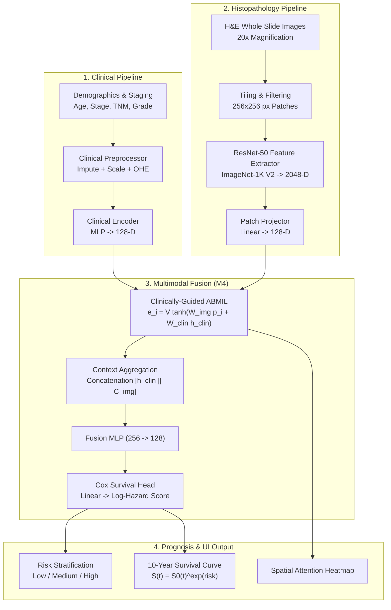

# CuraScope: Attention-Based Multimodal Deep Learning for Breast Cancer Survival Prognosis

[](https://fastapi.tiangolo.com)
[](https://reactjs.org/)
[](https://pytorch.org/)
[](https://tailwindcss.com/)
[](LICENSE)

CuraScope is an end-to-end multimodal deep learning prognosis system that fuses **H&E Whole-Slide Histopathology (WSI)** image features with **structured clinical parameters** to predict overall survival and stratify risk in breast cancer (TCGA-BRCA) patients.

---

## 🌟 Key Features

* **4 Systematic Model Architectures:**
  * **M1 (Clinical-Only):** 2-layer MLP on demographic and pathological staging features.
  * **M2 (Image-Only):** Mean-pooled 2048-D ResNet-50 patch embeddings mapped through a non-linear survival projection.
  * **M3 (Concat Fusion):** Naive feature-level multimodal concatenation baseline.
  * **M4 (Multimodal Attention - Proposed):** Clinically-guided Attention-Based Multiple Instance Learning (ABMIL) where clinical embeddings dynamically weight histopathology patches ($V^\top \tanh(W_{\text{img}} p_i + W_{\text{clin}} h_{\text{clin}})$).
* **Patient-Level 5-Fold Cross-Validation:** Leakage-free, event-stratified cross-validation with out-of-fold C-index evaluation.
* **Explainability Suite:**
  * Patch-level spatial attention maps and interactive heatmaps.
  * Clinical feature attribution via SHAP (KernelExplainer).
* **Full-Stack Clinical Web Dashboard:**
  * Real-time survival prognosis, risk tier classification (Low / Medium / High), and 10-year Kaplan-Meier dynamic projections.
  * Interactive WSI spatial patch grid with hover inspection.
  * Live H&E image upload with automatic patch tiling, ImageNet-1K V2 ResNet-50 feature extraction, and attention heatmap generation.

---

## 📊 Benchmark Results (297 Real Patient Cohort)

Evaluated across the 297-patient TCGA-BRCA cohort (37 observed death events, 4,901 comparable survival pairs) using patient-level 5-fold cross-validation:

| Model | Architecture | Mean C-Index | Std Dev | Pooled OOF C-Index |
| :--- | :--- | :---: | :---: | :---: |
| **M1** | Clinical Only (MLP) | 0.5721 | ±0.1615 | 0.5508 |
| **M2** | Image Only (Mean Pool) | 0.5988 | ±0.1206 | 0.5601 |
| **M3** | Concat Fusion | 0.5659 | ±0.0998 | 0.5485 |
| **M4** | **Clinically Guided ABMIL Attention** | **0.6722** | **±0.1223** | **0.6459** |

---

## 🏗️ System Architecture



---

## 🚀 Quick Start Guide

### Prerequisites
* Python 3.10+
* Node.js 18+ and npm

### 1. Clone the Repository
```bash
git clone https://github.com/NihilTechX/CuraScope-Cancer-detection.git
cd CuraScope-Cancer-detection
```

### 2. Backend Setup
```bash
# Create and activate a virtual environment (recommended)
python -m venv venv
# On Windows:
.\venv\Scripts\activate
# On Linux/macOS:
# source venv/bin/activate

# Install dependencies
pip install -r requirements.txt

# Start the FastAPI server
python -m uvicorn app.api:app --host 127.0.0.1 --port 8000 --reload
```
* Backend API will be live at: `http://127.0.0.1:8000`
* Swagger Interactive Docs: `http://127.0.0.1:8000/docs`

### 3. Frontend Setup
In a new terminal window:
```bash
cd frontend
npm install
npm run dev
```
* Access the web dashboard at: `http://localhost:5173` (or `http://localhost:3000`)

---

## 📁 Repository Structure

```text
├── app/                        # FastAPI application
│   ├── api.py                  # API endpoints, prediction pipeline, rate limiting
│   └── schemas.py              # Pydantic request/response schemas
├── configs/                    # Model training YAML configurations
│   ├── clinical_only.yaml
│   ├── image_only.yaml
│   ├── concat_fusion.yaml
│   └── multimodal_attention.yaml
├── dataset/                    # Cohort manifests, clinical/survival tables, sample images
│   ├── wsi_manifest_300.csv    # 300-patient slide manifest
│   ├── TCGA-BRCA.clinical.tsv  # Clinical metadata
│   ├── TCGA-BRCA.survival.tsv  # Survival ground truth (OS, OS.time)
│   ├── sample_he_images/       # Representative H&E histology demo images
│   └── patch_features/         # Extracted 2048-D patch embeddings (.pt)
├── frontend/                   # React 18 + Vite + Tailwind single-page application
│   ├── src/
│   │   ├── components/         # Reusable UI components & navigation
│   │   ├── views/              # Dashboard, Prognosis, Explainability, Architecture views
│   │   └── services/           # API integration service
├── results/
│   ├── checkpoints/            # Best model checkpoints (M1, M2, M3, M4)
│   ├── figures/                # Kaplan-Meier curves, SHAP plots, attention visualizations
│   └── metrics/                # Benchmark JSON summaries & cross-validation metrics
├── scripts/                    # Training, cross-validation, and feature extraction scripts
│   ├── 06_train_clinical_only.py
│   ├── 07_train_image_only.py
│   ├── 08_train_concat_fusion.py
│   ├── 09_train_attention_fusion.py
│   ├── 14_evaluate_all_models.py
│   └── kaggle_feature_extraction.py
├── src/                        # Core modeling and processing library
│   ├── data/                   # Clinical preprocessor, WSI datasets, patch extraction
│   ├── models/                 # Model factory, encoders, attention fusion, ResNet extractor
│   ├── training/               # Breslow Cox proportional hazards loss, survival trainer
│   └── evaluation/             # Concordance index (C-index), survival plotting
├── requirements.txt            # Python dependencies
└── README.md
```

---

## 🛡️ Security & Reliability Features

* **Strict Patient Isolation:** Zero cross-validation leakage between train, validation, and held-out test folds.
* **Rate Limiting:** Built-in sliding window rate limiter on inference endpoints.
* **Path Traversal Protection:** Regex validation and strict directory containment checks on slide and patient identifiers.
* **Thread-Safe Attention Hooks:** Context-isolated attention output avoiding global mutable state during concurrent requests.
* **Upload Limits:** Enforced 10MB payload cap on base64 image uploads to protect server memory.

---

## 📜 License
This project is licensed under the MIT License - see the [LICENSE](LICENSE) file for details.

## 🙏 Acknowledgements
* The Cancer Genome Atlas (TCGA) Breast Invasive Carcinoma (BRCA) research network.
* Genomic Data Commons (GDC) for WSI access.
